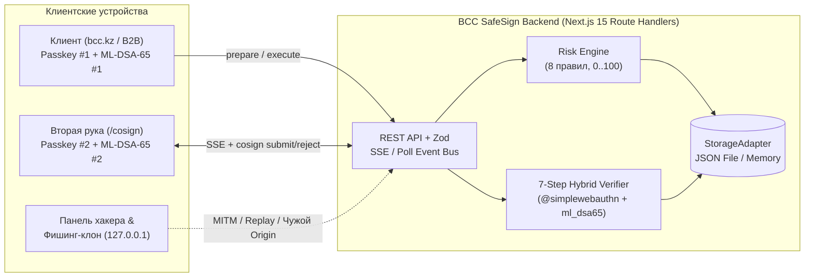

# BCC SafeSign

**Платформа гибридной криптографической подписи банковских операций без SMS для экосистемы `bcc.kz` (B2C) и `BCC Business` (B2B) — кейс АО «Банк ЦентрКредит» (ITU Hackathon 2026).**

`[Next.js 15.5 · TypeScript Strict]` `[ML-DSA-65 · NIST FIPS 204]` `[W3C WebAuthn · Passkeys]` `[Vitest · 8 тест-сьютов / 119 тестов]`

---

## Проблема → Решение

* **Уязвимость и дороговизна SMS-OTP:** одноразовые SMS-коды перехватываются через фишинговые сайты-клоны, SIM-swap и банковские трояны, никак криптографически не привязаны к сумме и счёту получателя и обходятся банкам Казахстана в сотни миллионов — миллиарды тенге ежегодно.
* **Социальная инженерия (>80% потерь):** под давлением телефонных мошенников («звонок из Нацбанка / КНБ») жертва добровольно диктует SMS-код или сама подтверждает перевод и онлайн-кредит на счёт дроппера.
* **Квантовая угроза:** классические асимметричные алгоритмы (`RSA` / `ECDSA`) требуют планового перехода на постквантовые стандарты NIST (FIPS 204).
* **Решение — BCC SafeSign:** модульный шлюз подтверждения транзакций, заменяющий SMS-коды двойной криптографической подписью **WebAuthn Passkey (ECDSA P-256) + Post-Quantum ML-DSA-65 (NIST FIPS 204)** над каноническим `SHA-256` дайджестом реквизитов (**WYSIWYS**).
* **Защита от социальной инженерии (Smart Co-Sign 2-of-2):** встроенный движок скоринга рисков автоматически переводит подозрительные и критические операции в режим «Второй руки» — деньги не списываются без второй независимой гибридной подписи доверенного родственника (`bcc.kz`) или директора компании (`BCC Business`).

---

## Ключевые фичи

* **Unphishable Passkeys (W3C WebAuthn):** приватный ключ привязан к домену банка (`rpId`) и разблокируется локальной биометрией (`TouchID` / `FaceID` / `Windows Hello`, `userVerification: "required"`). На фишинговом домене браузер не отдаёт ключ на аппаратном уровне. Для стендов без биометрического сенсора предусмотрен честный криптографический режим **Software WebAuthn Fallback** (`WebCrypto ECDSA P-256 + ML-DSA-65`).
* **WYSIWYS (*What You See Is What You Sign*):** все 15 полей операции (`CanonicalTxPayload`: сумма в тенге, IBAN отправителя и получателя, имя, назначение, тип операции, `rpId`, `createdAt`, `expiresAt`, 32-байтовый CSPRNG `nonce`) сериализуются в канонический JSON с лексикографической сортировкой ключей. Полученный дайджест `txHash = SHA-256(canonicalJson)` передаётся напрямую в `webAuthnOptions.challenge`. Подмена хотя бы 1 тиына или 1 символа IBAN после подписи математически разрушает обе подписи.
* **Постквантовый слой ML-DSA-65 (NIST FIPS 204):** параллельная постквантовая подпись на решётках (`@noble/post-quantum`, уровень безопасности NIST 3: открытый ключ `1 952 B`, закрытый ключ `4 032 B`, подпись `3 309 B`) с жёстким разделением доменов (`BCC-SAFESIGN-V1:PRIMARY:`, `BCC-SAFESIGN-V1:COSIGN:`, `BCC-SAFESIGN-V1:PQ-POP:`). На клиенте секретный ключ шифруется в `IndexedDB` через `AES-256-GCM` неэкспортируемым мастер-ключом `CryptoKey` (`extractable: false`).
* **Smart Co-Sign 2-of-2 («Вторая рука»):** `Risk & Social Engineering Engine` оценивает контекст операции по 8 правилам (`0..100` баллов). При высоком риске (`score >= 60`), закрытии депозита или оформлении онлайн-кредита в B2C, а также для корпоративных платежей от `500 000 ₸` в B2B транзакция переходит в `PENDING_COSIGN` и мгновенно доставляется по SSE на экран второго устройства. Вторая подпись математически «цементирует» и хэш транзакции, и `SHA-256` первой подписи инициатора, а кнопка **«Отклонить — это мошенники!»** блокирует перевод (`BLOCKED_BY_COSIGNER`) и включает 24-часовой период охлаждения (`coolingOffUntil`).
* **Интерактивная «Панель хакера» (6 реальных атак):**
  1. *MITM: Подмена суммы* (`15 000 ₸ → 500 000 ₸` после подписи клиента) → `403 ERR_WYSIWYS_TAMPERED` + пополевой `tamperDiff` и провал шагов 3, 5 и 6.
  2. *MITM: Подмена IBAN получателя* на дропперский счёт `KZ99856000000666DROP` → `403 ERR_WYSIWYS_TAMPERED`.
  3. *Replay Attack* (повторная отправка 100% валидного подписанного пакета) → `403 ERR_REPLAY_DETECTED`.
  4. *Фишинг-клон `bcc-bonus`* на чужом `origin` (`http://127.0.0.1:3000/phishing-clone`) → изоляция ключей браузером + серверный отказ `403 ERR_ORIGIN_MISMATCH`.
  5. *Социальная инженерия («Звонок из НБРК»)*: клиент сам подписывает перевод `850 000 ₸` на `KZ99856000000666DROP` во время активного звонка → `Risk Score = 95 (HIGH)` → перехват в `202 PENDING_COSIGN` → блокировка доверенным лицом.
  6. *Квантовая атака (алгоритм Шора)*: диагностическая симуляция компрометации классического слоя `ECDSA P-256` при работающей проверке `ML-DSA-65` → защита постквантовым слоем (`ERR_PQ_SIGNATURE_INVALID` при подделке PQ-подписи / `ERR_SIMULATION_ONLY`).
* **SOC-центр (`/soc`):** дашборд информационной безопасности банка с live-потоком событий (SSE + polling fallback), агрегированными KPI (отражённые атаки, спасённые средства в тенге, число операций без SMS, среднее время проверки `ML-DSA-65` в мс), фильтрацией инцидентов и встроенным `Crypto Inspector`.
* **ROI-калькулятор (`/roi`):** интерактивный расчёт финансового эффекта для БЦК с раздельным представлением прямой экономии операционного бюджета (OpEx на закупку A2P-SMS у операторов РК) и предотвращённого фрода, графиком накопленного эффекта за 12 месяцев и тремя пресетами («Консервативный», «Базовый (ТЗ)», «Оптимистичный»).

---

## Архитектура и 7-шаговый конвейер верификации



### 7-шаговая серверная верификация (`src/lib/crypto/hybrid-verifier.ts`)

Сервер проверяет каждую операцию (`primary` и `cosign`) строго последовательно, замеряя время каждого шага (`durationMs`) для отображения в `Crypto Inspector`:

| Шаг | Код проверки | Что проверяется на сервере | Код ошибки при отказе |
|---|---|---|---|
| **1** | `TX_EXISTENCE_AND_TTL` | Транзакция существует, статус соответствует роли (`CHALLENGE_ISSUED` или `PENDING_COSIGN`), не истёк TTL (`5 мин` для первичной подписи, `15 мин` для Co-Sign), устройство зарегистрировано за ожидаемым подписантом, а при `cosign` — физически и криптографически независимо от первого устройства (`enforceIndependentDevice`: разные `userId`, `credentialId`, `webAuthnPublicKey`, `pqPublicKey`). | `ERR_TX_NOT_FOUND` / `ERR_TX_EXPIRED` / `ERR_TX_STATE` / `ERR_DEVICE_NOT_ALLOWED` / `ERR_COSIGNER` |
| **2** | `REPLAY_PROTECTION` | Проверка, что одноразовый 32-байтовый `nonce` для данной роли ещё не использован (`nonceUsed === false` / `cosignNonceUsed === false`). | `ERR_REPLAY_DETECTED` |
| **3** | `WYSIWYS_INTEGRITY` | Пересчёт `SHA-256(serializeCanonicalJSON(submittedPayload))` и сверка с эталонным `storedTx.txHashHex`. При расхождении вычисляется пополевой `tamperDiff`, но сервер **не прерывает** проверку, а прогоняет шаги 4–6 против изменённого payload, доказывая математическую невалидность обеих подписей для подменённых реквизитов. | `ERR_WYSIWYS_TAMPERED` / `ERR_INVALID_INPUT` |
| **4** | `ORIGIN_AND_RPID` | Декодирование `clientDataJSON` и `authenticatorData`: проверка совпадения HTTP `Origin` и `clientDataJSON.origin` с `expectedOrigin`, флага `crossOrigin !== true`, равенства `rpIdHash === SHA-256(expectedRpId)` и соответствия `userHandle` владельцу устройства. | `ERR_ORIGIN_MISMATCH` / `ERR_WEBAUTHN_INVALID` |
| **5** | `WEBAUTHN_SIGNATURE` | `@simplewebauthn/server.verifyAuthenticationResponse()` проверяет аппаратную подпись `ECDSA P-256` над `expectedChallenge` (`base64url(txHash)` для инициатора или `base64url(SHA-256(msgCoSign))` для второй руки), флаг `userVerified: true` и счётчик `signCount`. В режиме квантовой симуляции шаг помечается `COMPROMISED`. | `ERR_WEBAUTHN_INVALID` |
| **6** | `POST_QUANTUM_ML_DSA` | Проверка длины подписи (`3 309 B`), невырожденности публичного ключа (`1 952 B`, ненулевой вектор $t_1 \neq 0$) и математическая верификация `ml_dsa65.verify(signature, domainPrefixedMessage, pqPublicKey)`. | `ERR_PQ_SIGNATURE_INVALID` |
| **7** | `RISK_AND_POLICY_GATE` | Блокировка диагностических симуляций (`ERR_SIMULATION_ONLY`), проверка повторного TTL, `coolingOffUntil`, лимитов и флага `acknowledgedWarning` (для `MEDIUM` риска), атомарное гашение `nonce`, обновление `webAuthnCounter`, перевод в `PENDING_COSIGN` (`HTTP 202`) либо проводка платежа в `EXECUTED` (`HTTP 200`). | `ERR_SIMULATION_ONLY` / `ERR_COOLING_OFF` / `ERR_INSUFFICIENT_FUNDS` / `ERR_ACK_REQUIRED` |

---

## Быстрый старт

### Требования
* **Node.js** `>= 22.12.0`
* Современный браузер с поддержкой WebAuthn и Web Crypto API (Chrome, Edge, Safari, Firefox)

### Установка и запуск

```bash
# 1. Установка зависимостей
npm install

# 2. Запуск dev-сервера (слушает 0.0.0.0:3000 — доступен на localhost и 127.0.0.1)
npm run dev

# 3. Запуск автотестов (Vitest)
npm test

# 4. Проверка линтером и production-сборка
npm run lint
npm run build

# 5. Быстрый smoke-тест всех основных API-эндпоинтов (при запущенном сервере)
./scripts/smoke.sh http://localhost:3000
```

### Переменные окружения

Все переменные имеют безопасные значения по умолчанию и не требуют создания `.env` для локального запуска:

| Переменная | Значение по умолчанию | Описание |
|---|---|---|
| `SAFESIGN_STORAGE` | `"file"` локально / `"memory"` при `VERCEL=1` | Режим хранилища (`src/lib/db/store.ts`): `"file"` сохраняет состояние в `./data/store.json`, `"memory"` использует in-memory адаптер в памяти процесса. |
| `SAFESIGN_RP_ID` | `"localhost"` | Relying Party ID для WebAuthn (`src/lib/crypto/webauthn.ts`). |
| `SAFESIGN_ORIGIN` | `"http://localhost:3000"` | Ожидаемый Origin банка при проверке `clientDataJSON.origin` и HTTP-заголовка `Origin` (`src/lib/crypto/webauthn.ts`). |

### Как открыть фишинг-клон на `127.0.0.1:3000`
Скрипт `npm run dev` запускает Next.js с флагом `-H 0.0.0.0`.
* Откройте основной стенд банка по адресу **`http://localhost:3000`**.
* Откройте фишинговый сайт-клон по адресу **`http://127.0.0.1:3000/phishing-clone`** (или нажмите кнопку открытия клона в «Панели хакера»).
* Для браузера `localhost` и `127.0.0.1` — это разные `origin` и разные `rpId`. Браузер не позволит странице на `127.0.0.1` использовать Passkey, привязанный к `localhost`, а при попытке отправки подписанного пакета с чужого origin сервер заблокирует запрос на шаге 4 с ошибкой `403 ERR_ORIGIN_MISMATCH`.

### Если на ноутбуке нет сканера TouchID / FaceID

Предусмотрены два способа полноценной работы без физического биометрического датчика:

1. **Встроенный режим Software Key (за 1 клик в UI):**
   * Нажмите **`Привязать устройство за 5 сек`** в верхней панели.
   * Включите чекбокс **«Нет сканера отпечатка (Software Key)»** и нажмите **«Привязать устройство»**.
   * В шапке появится бейдж `ECDSA + ML-DSA (Fallback)`. Клиент создаёт реальную ключевую пару `WebCrypto ECDSA P-256` (с упаковкой COSE/CBOR и ASN.1 DER-подписью в `src/lib/crypto/software-authenticator.ts`) + ключ `ML-DSA-65`. Сервер проверяет их тем же конвейером `@simplewebauthn/server` и `ml_dsa65.verify`.
2. **Виртуальный аутентификатор Chrome DevTools (аппаратная эмуляция W3C WebAuthn):**
   * Откройте `Chrome DevTools` → меню `⋮` → `More tools` → **`WebAuthn`**.
   * Включите **`Enable virtual authenticator environment`**.
   * Укажите `Protocol: CTAP2`, `Transport: Internal`, отметьте `Supports resident keys` и `Supports user verification` → нажмите **`Add`**.

---

## Сценарий демо за 3 минуты

Полный посекундный сценарий с дословными репликами спикера, префлайт-чеклистом и планом «Б» находится в **[`docs/PITCH.md`](docs/PITCH.md)**.

| Тайминг | Этап демонстрации | Что показываем на экране |
|---|---|---|
| **0:00 – 0:30** | **1. Проблема и Деньги** | Главный экран (`/`), режим `bcc.kz (Семья)`, счёт Айгуль Сатыбалдиевой (`1 200 000 ₸`, депозит `2 500 000 ₸`, доверенное лицо — сын Арман). |
| **0:30 – 1:00** | **2. Перевод без SMS** | Пресет **«Другу 15 000 ₸»** → `Risk Score: 0 (LOW)` → модалка **WYSIWYS** → касание TouchID / Software Key → `EXECUTED`. Открываем **Crypto Inspector**: канонический JSON, `clientDataJSON`, подпись `ML-DSA-65` (`3 309 B`) и время проверки (`~3 мс`). |
| **1:00 – 1:45** | **3. Шоу атак в Панели хакера** | 1) Включаем тумблер **MITM: Сумма → 500 000 ₸** и подписываем `15 000 ₸` → красный щит `403 ERR_WYSIWYS_TAMPERED` + `TamperDiffViewer` + провал шагов 3, 5, 6.<br/>2) Жмём **Replay Attack** → `403 ERR_REPLAY_DETECTED`.<br/>3) Открываем **Фишинг-клон** (`127.0.0.1:3000/phishing-clone`) → блок по `origin` (`403 ERR_ORIGIN_MISMATCH`). |
| **1:45 – 2:30** | **4. Социальная инженерия и Co-Sign 2-of-2** | Пресет **«Мошеннику 850 000 ₸»** (счёт `KZ99856000000666DROP` + активный звонок) → `Risk Score: 95 (HIGH)` → клиент сам подписывает → статус `202 PENDING_COSIGN`. На экране «Второй руки» (встроенный таб или `/cosign` на втором телефоне) сын Арман видит причины риска и жмёт **«Отклонить — это мошенники!»** → `BLOCKED_BY_COSIGNER` + 24ч период охлаждения. Переключаем режим на `BCC Business (МСБ)` (бухгалтер Динара + директор Тимур для платежей от `500 000 ₸`). |
| **2:30 – 3:00** | **5. SOC-центр и ROI** | Вкладка **`/soc`** (телеметрия всех только что отражённых атак и спасённые `850 000 ₸`) → вкладка **`/roi`** (`2,268 млрд ₸/год` прямой экономии OpEx на SMS + `1,05 млрд ₸/год` предотвращённого фрода в базовом сценарии; `360 млн ₸/год` + `400 млн ₸/год` в консервативном). |

---

## Структура репозитория

```text
bcc-safesign/
├── BCC_SafeSign_TZ.md                  # Техническое задание (источник истины)
├── docs/
│   ├── PITCH.md                        # Посекундный сценарий 3-минутного демо и аудит цифр ROI
│   ├── JURY_QA.md                      # База из 25+ ответов на вопросы жюри (ИБ, CISO, регулятор, CFO)
│   ├── AUDIT_CORE.md                   # Отчёт криптоаудита ядра (AUDIT-01..AUDIT-12) и статус исправлений
│   └── DESIGN.md                       # Спецификация дизайн-системы, токенов и компонентов
├── scripts/
│   └── smoke.sh                        # Smoke-проверка HTTP API-эндпоинтов через curl
├── src/
│   ├── app/
│   │   ├── layout.tsx                  # Общий shell, Topbar, провайдеры режима демо и тостов
│   │   ├── page.tsx                    # Главный Split-Screen демо-стенд (Клиент + Панель хакера / Co-Sign)
│   │   ├── cosign/page.tsx             # Полноэкранный кабинет «Второй руки» (Доверенное лицо / Директор)
│   │   ├── soc/page.tsx                # SOC-дашборд мониторинга атак и криптографических метрик
│   │   ├── roi/page.tsx                # Интерактивный ROI-калькулятор экономии БЦК на отказе от SMS
│   │   ├── phishing-clone/             # Фишинговый сайт-клон для демонстрации защиты Origin / RP ID
│   │   ├── dev/kit/                    # Инженерный стенд UI-кита и проверки подписи в браузере
│   │   └── api/                        # Next.js Route Handlers (Zod-валидация + Zero-Crash JSON)
│   │       ├── auth/register/options/  # POST: генерация WebAuthn RegistrationOptions
│   │       ├── auth/register/verify/   # POST: верификация WebAuthn аттестации + ML-DSA-65 PoP
│   │       ├── devices/                # GET / DELETE: список и отзыв привязанных устройств
│   │       ├── users/                  # GET: демо-персонажи и их актуальные балансы
│   │       ├── risk/preview/           # POST: живой расчёт Risk Score (0..100) для формы перевода
│   │       ├── transactions/           # GET: список транзакций; [id]/GET: детали транзакции
│   │       ├── transactions/prepare/   # POST: выпуск CanonicalTxPayload, txHash и WebAuthn challenge
│   │       ├── transactions/execute/   # POST: 7-шаговая гибридная верификация первичной подписи
│   │       ├── transactions/cosign/    # POST: prepare / submit / reject для «Второй руки» (2-of-2)
│   │       ├── events/stream/          # GET: Server-Sent Events (SSE) поток реального времени
│   │       ├── events/poll/            # GET: HTTP-polling fallback для доставки событий
│   │       ├── soc/events/             # GET: лента событий ИБ и агрегированные KPI для SOC
│   │       └── demo/reset/             # POST: сброс демо-стенда с опцией сохранения Passkeys
│   ├── components/
│   │   ├── ui/                         # Базовые примитивы (Button, Card, Badge, Modal, Drawer, PhoneFrame и др.)
│   │   ├── shell/                      # Topbar, DemoModeProvider, AppProviders
│   │   ├── bank/                       # Компоненты клиентского банка и RiskMeter
│   │   ├── cosign/                     # Карточки запросов Co-Sign, QR-ссылка, лента и встроенный экран
│   │   ├── hacker/                     # Панель симуляции атак и щит AttackBlockedShield
│   │   ├── crypto/                     # VerificationStepsList, JsonDiffViewer, LatencyBadge, Inspector
│   │   ├── soc/                        # SocDashboard, графики распределения атак, шторка инцидента
│   │   └── roi/                        # SmsRoiCalculator, ползунки, SVG-график накопленного эффекта
│   └── lib/
│       ├── crypto/                     # canonical.ts, mldsa.ts, webauthn.ts, hybrid-verifier.ts,
│       │                               # client-keystore.ts (IndexedDB+AES-GCM), software-authenticator.ts
│       ├── risk/engine.ts              # Risk & Social Engineering Engine (8 правил скоринга)
│       ├── tx/                         # service.ts, inputs.ts (Zod-схемы), errors.ts
│       ├── devices/service.ts          # Сервис онбординга, проверки уникальности ключей и отзыва устройств
│       ├── soc/service.ts              # Агрегация метрик и фильтрация журнала SOC
│       ├── roi/calc.ts                 # Формулы ROI, пресеты и форматирование валюты
│       ├── db/                         # types.ts, seed.ts, store.ts (MemoryAdapter / JsonFileAdapter)
│       ├── events/                     # In-process pub/sub шина событий, SSE stream и фильтр запросов
│       ├── client/                     # Клиентский SDK подписи, хуки состояния, SSE и IndexedDB
│       ├── demo/participants.ts        # Конфигурация пар участников B2C и B2B
│       └── ui/                         # Форматирование сумм/дат и настройки анимаций Framer Motion
└── tests/                              # Автотесты Vitest (криптопротокол, 6 атак, аудит, Co-Sign, API, ROI)
```

---

## Безопасность, аудит и граница MVP vs Production

Подробный разбор архитектуры безопасности вынесен в отдельные документы:
* **[`docs/AUDIT_CORE.md`](docs/AUDIT_CORE.md)** — независимый аудит криптографического и транзакционного ядра (`AUDIT-01` .. `AUDIT-12`) с описанием закрытых векторов атак и проверкой инвариантов.
* **[`docs/JURY_QA.md`](docs/JURY_QA.md)** — матрица угроз STRIDE и ответы на 25+ вопросов от криптографов, CISO, продуктовых директоров, инженеров интеграции и регулятора (АРРФР / НБРК).

### Граница MVP и Production по модели STRIDE

| Категория STRIDE | Угроза | Реализация в MVP (`BCC SafeSign`) | Усиление в Production (`bcc.kz` / `BCC Business`) |
|---|---|---|---|
| **S — Spoofing** | Фишинг-клон `bcc-bonus`, кража OTP | WebAuthn `rpId` + проверка HTTP `Origin`, `clientDataJSON.origin`, `crossOrigin !== true` и `rpIdHash` (`ERR_ORIGIN_MISMATCH`). | Привязка ключей к мобильному приложению через Apple Associated Domains / Android Digital Asset Links. |
| **T — Tampering** | MITM-подмена суммы или IBAN после подписи | WYSIWYS: `challenge = base64url(SHA-256(canonicalPayload))` + подпись `ML-DSA-65` + пополевой `tamperDiff` (`ERR_WYSIWYS_TAMPERED`). | Вывод реквизитов через защищённый системный экран Android Protected Confirmation / TEE Trusted UI. |
| **R — Repudiation** | Отказ от авторства операции | Двойная подпись (`ECDSA P-256 + ML-DSA-65`), криптографическое связывание 2-of-2 через `SHA-256(primarySig)`, журнал `SecurityEvent` в SOC. | Архивное хранение криптопакетов в WORM-хранилище банка + штампы времени TSP / интеграция с ЭЦП НУЦ РК при необходимости. |
| **I — Information Disclosure** | Кража закрытого ключа `ML-DSA-65` из браузера | Шифрование секретного ключа (`4 032 B`) в `IndexedDB` через `AES-256-GCM` неэкспортируемым `CryptoKey` (`extractable: false`) с привязкой `additionalData` к устройству и пользователю. | Генерация и хранение 32-байтового `seed` `ML-DSA-65` внутри аппаратного модуля iOS Secure Enclave / Android StrongBox Keystore. |
| **D — Denial of Service / Replay** | Повторная отправка пакета / гонки запросов | Одноразовый 32-байтовый `nonce` + TTL (`5 мин` / `15 мин`) + проверка счётчика `signCount` + проверка прав устройства до сжигания `nonce` (`ERR_REPLAY_DETECTED`). | Атомарное гашение `nonce` в Redis Cluster (`SET NX EX`) + mTLS и Rate Limiting на уровне API Gateway. |
| **E — Elevation of Privilege / Social Engineering** | Жертва сама подписывает перевод под диктовку мошенника | `Risk Engine` (`0..100`) + обязательный **Smart Co-Sign 2-of-2** на независимом устройстве + 24ч период охлаждения `coolingOffUntil`. | Интеграция с телеметрией супераппа `bcc.kz` (детекция RAT/AnyDesk, активного GSM/VoIP-вызова) и фидами дропперов Антифрод-центра НБРК. |

### Принятые риски MVP (`Accepted Risks`)
1. **Межпроцессная синхронизация хранилища (`AUDIT-03`):** внутри одного процесса Node.js все операции `transact()` и `consumeNonce()` сериализуются через `Mutex` в `SerializedAdapter` (параллельные атаки через `Promise.all` внутри процесса пропускают строго один запрос). Однако файловый адаптер `JsonFileAdapter` (`./data/store.json`) и `MemoryAdapter` не используют межпроцессные блокировки ОС или распределённый CAS (в `tests/audit.test.ts` этот сценарий явно задокументирован тестом `it.fails`). В Production-контуре БЦК состояние хранится в PostgreSQL и Redis Cluster с атомарными транзакциями.
2. **Экстренная блокировка «Второй рукой» без криптоподписи (`AUDIT-08`):** роут `POST /api/transactions/cosign/reject` принимает `cosignerUserId` без требования WebAuthn/ML-DSA подписи. Это осознанное продуктовое решение для «стоп-крана»: доверенное лицо должно иметь возможность за 1 клик заблокировать мошеннический перевод и включить 24-часовой `coolingOffUntil`, даже если на его телефоне ещё не завершена привязка криптоключа. В Production вызов защищается штатной сессионной авторизацией банковского приложения.

---

## Карта страниц

| Маршрут | Назначение страницы | Ключевые элементы |
|---|---|---|
| **`/`** | Главный Split-Screen «Демо-стенд» | Левая колонка: смартфон клиента (`bcc.kz` / `BCC Business`), пресеты операций, живой `RiskMeter`, модалка WYSIWYS. Правая колонка: переключаемые вкладки «Панель хакера (6 атак)» с 7-шаговым трейсом / `TamperDiffViewer` и встроенный экран «Второй руки (Co-Sign Live)». |
| **`/cosign`** | Полноэкранный кабинет «Второй руки» (mobile-first) | Отдельный экран для второго смартфона (по QR-коду или прямой ссылке): переключатель профилей «Доверенное лицо (Арман)» / «Директор (Тимур)», привязка второго устройства, live-лента `PENDING_COSIGN` по SSE, кнопки двойной подписи `2-of-2` и экстренной блокировки с заморозкой счёта на 24 часа. |
| **`/soc`** | SOC-центр банка | 4 KPI-индикатора в реальном времени, диаграмма распределения отражённых атак по векторам, фильтруемая таблица событий ИБ и выдвижная шторка `SocEventDetailDrawer` с полным криптографическим разбором транзакции. |
| **`/roi`** | ROI-калькулятор для БЦК | 6 интерактивных ползунков ($U, N, P, M, F, R$), 3 сценария («Консервативный», «Базовый (ТЗ)», «Оптимистичный»), раздельные карточки прямой экономии OpEx на SMS и предотвращённого фрода, сравнение расходов «До / После» и 12-месячный SVG-график. |
| **`/phishing-clone`** | Фишинговый сайт-клон `bcc-bonus` | Демонстрация атаки №4 на альтернативном origin (`http://127.0.0.1:3000/phishing-clone`): визуальная приманка, реальная блокировка Passkey браузером из-за несовпадения `rpId`/`origin` и демонстрация серверного отказа `403 ERR_ORIGIN_MISMATCH`. |
| **`/dev/kit`** | Инженерная витрина UI-кита | Песочница базовых компонентов дизайн-системы (`#07110E` / `#0D1B17` / `#00D084` / `#F59E0B` / `#EF4444`) и интерактивная проверка регистрации и подписи в браузере. |

---

## Отклонения от ТЗ и инженерные улучшения

В ходе разработки и криптографического аудита ([`docs/AUDIT_CORE.md`](docs/AUDIT_CORE.md)) в проект внесены 4 осознанных уточнения относительно исходного текста `BCC_SafeSign_TZ.md`:

1. **Стартовый баланс Айгуль — `1 200 000 ₸` вместо `450 000 ₸` (ТЗ §6.2, `AUDIT-12`):**
   В `src/lib/db/seed.ts` баланс текущего счёта `usr_aigul` установлен в `1 200 000 ₸` (депозит `2 500 000 ₸` сохранён без изменений). Это позволяет на живой демонстрации показать оба исхода сценария на `850 000 ₸`: как блокировку перевода доверенным лицом (`BLOCKED_BY_COSIGNER`), так и успешное одобрение второй подписью (`EXECUTED`) без отказа по `ERR_INSUFFICIENT_FUNDS`.
2. **Операции онлайн-кредита и закрытия депозита в B2C всегда требуют Co-Sign 2-of-2 (`AUDIT-07`):**
   В ТЗ §5.1 правило `CRITICAL_OP_TYPE` имеет вес `+55` баллов при пороге `HIGH = 60` (§5.2), из-за чего кредит или закрытие депозита на сумму `< 200 000 ₸` в адрес доверенного получателя набирали `55` баллов (`MEDIUM`) и могли исполняться без второй подписи. В `src/lib/risk/engine.ts` и `src/lib/tx/service.ts` все операции `ONLINE_LOAN` и `DEPOSIT_CLOSE` в режиме `B2C` принудительно переводятся на уровень `HIGH` (`requiresCoSign: true`) с добавлением причины политики банка. Кроме того, при `DEPOSIT_CLOSE` средства зачисляются строго на собственный счёт клиента (`sender.accountIban`), а для `ONLINE_LOAN` введён лимит совокупной задолженности `3 000 000 ₸`.
3. **Криптографический Proof-of-Possession (PoP) и отсев вырожденных ключей ML-DSA-65 при регистрации (`AUDIT-01`):**
   В отличие от базовой схемы ТЗ §4.2 и §7.1, проверявшей при онбординге только длину открытого ключа `pqPublicKeyBase64` (`1 952 B`), эндпоинт `POST /api/auth/register/verify` требует поле `pqProofOfPossessionBase64` — валидную подпись `ML-DSA-65` над сообщением:
   ```text
   utf8("BCC-SAFESIGN-V1:PQ-POP:") || SHA-256(utf8(userId) || 0x00 || utf8(credentialId) || 0x00 || utf8(registrationChallenge))
   ```
   Дополнительно сервер отвергает вырожденные открытые ключи с нулевым полиномиальным вектором $t_1 = 0$ (`publicKey.subarray(32)` из нулевых байтов, позволяющий подделывать подписи без секретного ключа) и запрещает повторную регистрацию совпадающих `credentialId`, `webAuthnPublicKey` или `pqPublicKey`.
4. **Раздельное представление экономии OpEx банка и предотвращённого фрода в ROI (`/roi`):**
   В ТЗ §9.5 прямая экономия банка на SMS (`2,268 млрд ₸/год`) и спасённый фрод (`1,05 млрд ₸/год`) суммируются в единый показатель (`3,318 млрд ₸/год`). Чтобы исключить методологическое смешение прямого P&L банка (OpEx на оплату SMS операторам связи) и защищённых средств клиентов / кредитного портфеля, в `src/components/roi/SmsRoiCalculator.tsx` эти показатели вынесены в две независимые главные карточки, а блок совокупного эффекта и стресс-тест («Консервативный» сценарий: `360 млн ₸/год` на SMS + `400 млн ₸/год` предотвращённого фрода) снабжены прозрачным пояснением методологии.
