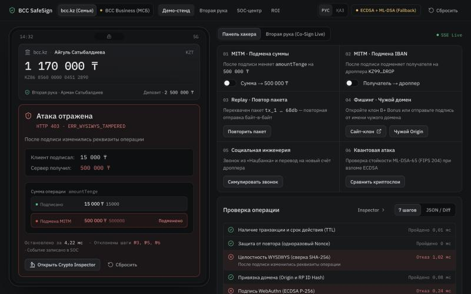
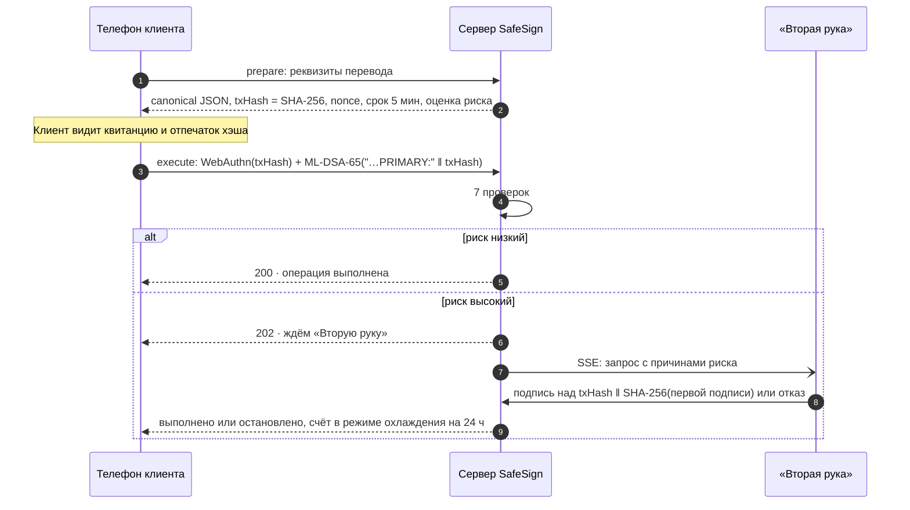
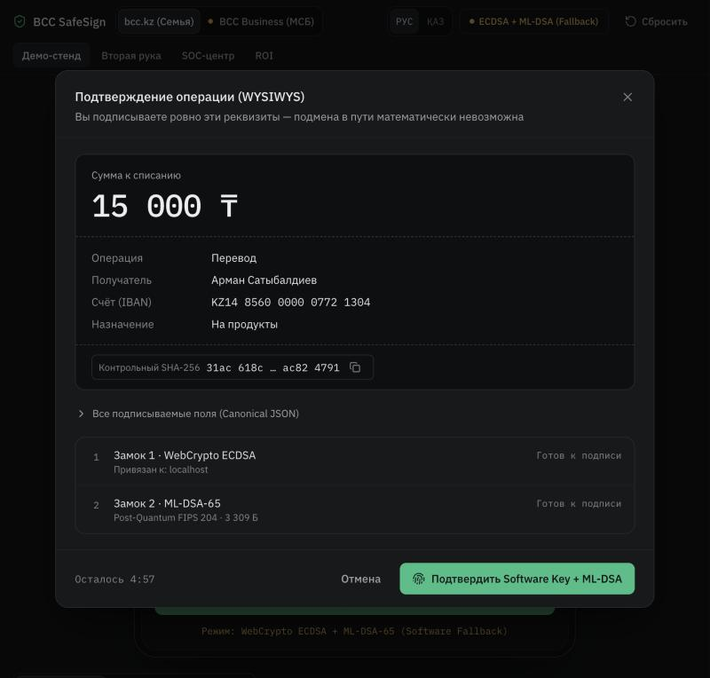
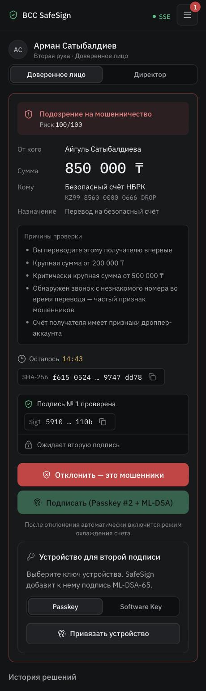
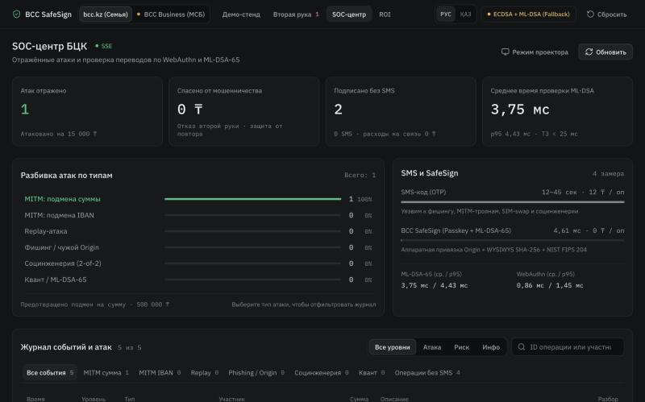
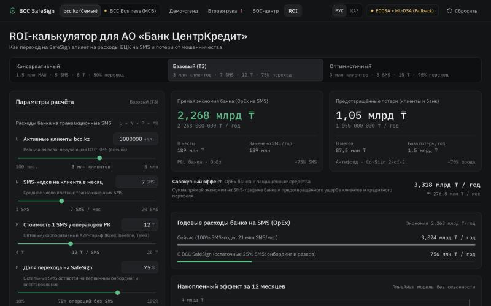

# BCC SafeSign

Подтверждение банковских операций без SMS-кодов. Клиент подписывает перевод Passkey и постквантовой подписью ML-DSA-65 ровно над тем, что видит на экране. Если перевод похож на мошенничество, деньги не уйдут без второй подписи доверенного человека.

MVP для кейса АО «Банк ЦентрКредит» на ITU Hackathon 2026: банк bcc.kz для семей и BCC Business для компаний, на русском и казахском.

`Next.js 15` · `TypeScript strict` · `WebAuthn / Passkeys` · `ML-DSA-65 (NIST FIPS 204)` · `151 автотест` · `RU / KZ`



<sub>Клиент подписал 15 000 ₸, перехватчик отправил на сервер 500 000 ₸. Хэш реквизитов не совпал, обе подписи для новой суммы недействительны, и сервер отклонил операцию на шагах 3, 5 и 6.</sub>

## Зачем

SMS-код ничего не знает о том, что вы подтверждаете. Это 4–6 цифр, не связанных ни с суммой, ни с получателем. Поэтому:

- код вводят на сайте-клоне, и он уходит злоумышленнику;
- код читают с перевыпущенной SIM-карты или из уведомлений;
- реквизиты подменяют по дороге, а код остаётся тем же;
- под давлением «звонка из Нацбанка» человек сам диктует код.

К тому же банк платит операторам связи за каждое сообщение.

## Как это работает

Подпись строится из четырёх слоёв, и каждый закрывает свою атаку.

| Слой | Что даёт |
|---|---|
| **Passkey (WebAuthn)** | Ключ хранится в устройстве и привязан к домену банка. Диктовать нечего, а сайт-клон подпись не получит |
| **WYSIWYS** (*What You See Is What You Sign*) | Challenge для WebAuthn — это SHA-256 канонического JSON с реквизитами, а не случайное число. Подпись нельзя перенести на другую сумму или другого получателя |
| **ML-DSA-65** (NIST FIPS 204) | Вторая, постквантовая подпись над тем же хэшем. Если ECDSA когда-нибудь сломают, второй замок останется |
| **«Вторая рука»** (Smart Co-Sign 2-of-2) | Рискованный перевод ждёт подтверждения доверенного лица или директора. Вторая подпись включает хэш первой, и цепочку не разорвать |



### Семь серверных проверок

Каждая проверка замеряется и видна в Crypto Inspector. Криптографический отказ возвращает `403` с кодом ошибки и номером шага.

| Шаг | Проверка | Код при отказе |
|---|---|---|
| 1 | Транзакция существует, срок не истёк, устройство принадлежит подписанту | `ERR_TX_NOT_FOUND`, `ERR_TX_EXPIRED` |
| 2 | Одноразовый nonce ещё не использован | `ERR_REPLAY_DETECTED` |
| 3 | SHA-256 присланных реквизитов совпадает с выданным | `ERR_WYSIWYS_TAMPERED` и разница полей |
| 4 | Origin и RP ID совпадают с доменом банка | `ERR_ORIGIN_MISMATCH` |
| 5 | Подпись WebAuthn (ECDSA P-256) верна | `ERR_WEBAUTHN_INVALID` |
| 6 | Подпись ML-DSA-65 верна | `ERR_PQ_SIGNATURE_INVALID` |
| 7 | Риск и политика банка: исполнение или «Вторая рука» | `ERR_COOLING_OFF`, `ERR_INSUFFICIENT_FUNDS` |

При подмене реквизитов сервер не останавливается на шаге 3. Он прогоняет шаги 5 и 6 против подменённого хэша и показывает, что обе подписи для него недействительны.

## Шесть атак, которые можно нажать самому

Панель хакера на главном экране отправляет настоящие пакеты в `/api/transactions/execute`. Каждая атака ломается в криптографии, а не в условном операторе.

| Атака | Что делает атакующий | Ответ сервера |
|---|---|---|
| Подмена суммы | Клиент подписал 15 000 ₸, на сервер ушло 500 000 ₸ | `403` · шаги 3, 5, 6 |
| Подмена получателя | IBAN заменён на счёт дроппера | `403` · шаги 3, 5, 6 |
| Повтор пакета | Валидный подписанный пакет отправлен ещё раз байт в байт | `403` · шаг 2 |
| Фишинг-клон | Подпись со страницы на чужом origin `127.0.0.1` | Браузер не отдаёт Passkey; программный ключ отклоняется на шаге 4 |
| Квантовая атака | ECDSA считается взломанным, ML-DSA подделан чужим ключом | `403` · шаг 6 |
| Социальная инженерия | Обе подписи настоящие, но риск 100/100 | `202` · ждём «Вторую руку» |

Risk Engine оценивает операцию по восьми правилам от 0 до 100: новый получатель, крупная сумма, звонок с незнакомого номера во время перевода, ночное время, признаки дроппера и другие. При 60 баллах и выше, при закрытии депозита или онлайн-кредите перевод ждёт «Вторую руку». В BCC Business платежи от 500 000 ₸ подтверждает директор.

## Экраны

<table>
<tr>
<td width="62%" valign="top"></td>
<td valign="top"></td>
</tr>
<tr>
<td valign="top"><b>Окно подписи.</b> Квитанция с суммой, реквизитами и отпечатком SHA-256. Тот же отпечаток потом видят сервер, «Вторая рука» и SOC</td>
<td valign="top"><b>«Вторая рука».</b> Сын получает запрос по SSE и одним нажатием останавливает перевод мошеннику</td>
</tr>
</table>

<table>
<tr>
<td width="50%"></td>
<td width="50%"></td>
</tr>
<tr>
<td><b>SOC-центр.</b> Отражённые атаки по типам, журнал событий и время проверки ML-DSA</td>
<td><b>ROI.</b> 2,268 млрд ₸ в год прямой экономии на SMS и 1,05 млрд ₸ предотвращённого фрода в базовом сценарии</td>
</tr>
</table>

| Адрес | Экран |
|---|---|
| `/` | Демо-стенд: телефон клиента, панель хакера, вердикт сервера, вкладка «Вторая рука» |
| `/cosign` | Кабинет «Второй руки» для второго телефона: доверенное лицо или директор |
| `/soc` | SOC-центр банка с режимом для проектора |
| `/roi` | Калькулятор экономии с консервативным, базовым и оптимистичным сценарием |
| `/phishing-clone` | Учебный сайт-клон для атаки с чужого origin |

## Быстрый старт

Нужны Node.js 22.12 или новее и браузер с WebAuthn: Chrome, Edge, Safari или Firefox.

```bash
git clone https://github.com/KItsunexdd/sudo-love-me-TIU.git
cd sudo-love-me-TIU
npm install
npm run dev
```

Стенд откроется на <http://localhost:3000>. `.env` не нужен, у всех настроек есть безопасные значения по умолчанию.

- **Нет TouchID или Windows Hello.** Нажмите «Привязать устройство за 5 сек» и отметьте «Нет сканера отпечатка (Software Key)». Браузер создаст настоящую пару ключей ECDSA P-256 через WebCrypto, а сервер проверит её тем же `@simplewebauthn/server`. Подойдёт и виртуальный аутентификатор Chrome: DevTools → More tools → WebAuthn.
- **Фишинг-клон.** Откройте <http://127.0.0.1:3000/phishing-clone>. Для браузера `localhost` и `127.0.0.1` — разные домены, поэтому Passkey банка на клоне недоступен.
- **Второй телефон.** На вкладке «Вторая рука» есть QR-код на `/cosign`. Отклонить запрос можно с любого устройства. Для подписи со второго телефона нужен HTTPS: по HTTP на адресе в локальной сети браузер телефона блокирует и Passkey, и WebCrypto.

| Переменная | По умолчанию | Назначение |
|---|---|---|
| `SAFESIGN_ORIGIN` | `http://localhost:3000` | Origin банка, который ждут WebAuthn и CSRF-проверка |
| `SAFESIGN_RP_ID` | `localhost` | Relying Party ID для Passkeys |
| `SAFESIGN_STORAGE` | `file`, на Vercel `memory` | Хранилище: `data/store.json` или память процесса |

## Проверки

| Команда | Что делает |
|---|---|
| `npm test` | 151 тест Vitest: протокол, шесть атак, цепочка 2-of-2, API, SSE, риск, ROI, полнота казахского словаря. Ещё два `it.fails` фиксируют известные ограничения MVP |
| `npm run e2e` | Playwright: полный сценарий защиты, блокировка Passkey на клоне, мобильная «Вторая рука» на 375×812, казахский интерфейс. Один раз нужен `npx playwright install chromium` |
| `npm run lint` · `npm run build` | ESLint и production-сборка со строгой проверкой типов |
| `npm run bench` | Замеры криптографии, результаты пишутся в [docs/BENCHMARKS.md](docs/BENCHMARKS.md) |
| `npm run preflight` | Проверка запущенного стенда перед показом: заголовки безопасности, SSE, сквозной перевод, сброс демо |

Основные экраны и диалоги проверены axe-core: нарушений WCAG не найдено.

## Производительность

Apple M4, Node.js 26, по 200 замеров на операцию ([полная таблица](docs/BENCHMARKS.md)):

| Операция | Медиана | p95 |
|---|---:|---:|
| Подпись ML-DSA-65 | 6,6 мс | 18,7 мс |
| Проверка ML-DSA-65 | 1,5 мс | 1,5 мс |
| Вся серверная проверка, 7 шагов | 1,8 мс | 1,9 мс |
| Полный цикл: prepare → подпись → execute | 7,8 мс | 22,0 мс |

Размеры: открытый ключ ML-DSA-65 — 1 952 байта, подпись — 3 309 байт, тело запроса execute — около 5,7 КБ. Подпись ML-DSA по p95 не укладывается в цель 15 мс из ТЗ: алгоритм вероятностный, и редкие повторы удлиняют подпись. Медиана при этом 6,6 мс.

## Устройство

| Модуль | Где |
|---|---|
| Канонический JSON и SHA-256 | `src/lib/crypto/canonical.ts` |
| ML-DSA-65 с разделением доменов `BCC-SAFESIGN-V1:PRIMARY / COSIGN / PQ-POP` | `src/lib/crypto/mldsa.ts` |
| Семь проверок сервера | `src/lib/crypto/hybrid-verifier.ts` |
| Risk Engine, восемь правил | `src/lib/risk/engine.ts` |
| Операции, Co-Sign, режим охлаждения | `src/lib/tx/service.ts` |
| Хранилище ключей клиента: IndexedDB и AES-256-GCM с неизвлекаемым ключом | `src/lib/crypto/client-keystore.ts` |
| Программный аутентификатор ECDSA P-256 | `src/lib/crypto/software-authenticator.ts` |
| Сценарии атак панели хакера | `src/components/hacker/attacks.ts` |
| API, 16 маршрутов с валидацией zod | `src/app/api` |
| Словари RU и KZ | `src/lib/i18n` |

Стек: Next.js 15 (App Router), React 19, TypeScript, Tailwind CSS, `@simplewebauthn/browser` и `@simplewebauthn/server`, `@noble/post-quantum`, `@noble/hashes`, zod, framer-motion, Vitest, Playwright. Самописной криптографии в проекте нет.

## Границы MVP

Протокол рабочий, а вокруг него стоят упрощения для стенда. Каждое из них закрывается интеграцией с инфраструктурой банка, переписывать протокол не нужно.

| Сейчас | В production |
|---|---|
| Демо-персонажи без входа в систему | Сессия bcc.kz, привязка userId |
| Состояние в `data/store.json` или в памяти, без межпроцессных блокировок | PostgreSQL и атомарный nonce в Redis Cluster |
| Ключ ML-DSA в IndexedDB под AES-GCM | Secure Enclave или StrongBox |
| Экран подтверждения в браузере | Доверенный UI, Android Protected Confirmation |
| Привязка к домену через rpId и origin | Associated Domains и Digital Asset Links |
| Восемь правил Risk Engine | Антифрод-скоринг БЦК и телеметрия удалённого доступа |

Подробности — в отчётах проверок: [криптоаудит ядра](docs/AUDIT_CORE.md), [red team](docs/REDTEAM.md) и [финальное ревью](docs/FINAL_REVIEW.md).

## Документация

- [docs/PITCH.md](docs/PITCH.md) — сценарий трёхминутного демо по секундам с репликами
- [docs/CHEATSHEET.md](docs/CHEATSHEET.md) — шпаргалка спикера на одну страницу
- [docs/JURY_QA.md](docs/JURY_QA.md) — ответы на вопросы жюри: безопасность, регулятор, экономика
- [docs/DESIGN.md](docs/DESIGN.md) — дизайн-система интерфейса
- [docs/BENCHMARKS.md](docs/BENCHMARKS.md) — замеры производительности
- [BCC_SafeSign_TZ.md](BCC_SafeSign_TZ.md) — техническое задание
